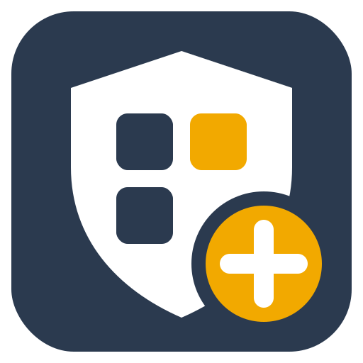
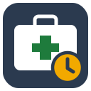
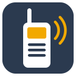
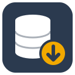

<p align="center">&nbsp;&nbsp;&nbsp;&nbsp;&nbsp;&nbsp;&nbsp;&nbsp;</p>

# Incident Report Manager, Field Toolkit & Field Map

This repository holds three native Windows desktop applications (C# / WinForms, .NET 8). All work fully
offline and store their data locally:

* **[Incident Report Manager](#incident-report-manager)** records, tracks and prints incident reports.
* **[Field Toolkit](#field-toolkit)** is a multi-window toolkit for rugged in-vehicle laptops: first aid
  guide, CPR helper, hazmat lookup, GPS location, timers, checklists, kit expiry tracker, and a radio &
  comms reference.
* **[Field Map](#field-map)** is an offline, CAD-style map for emergency response in British Columbia and
  Alberta: search, "What's here?", nearest facilities by drive time, turn-by-turn directions, incident
  drawing tools and offline-safe map updates.

The apps share branding, the switchable **Touch Mode** (Ctrl+T), the high-contrast **Daylight** theme
(Ctrl+D) and the **Night** theme (Ctrl+N) through `src/Shared`, and coordinate/GPS code through
`src/Shared.Core` and `src/Shared.Location`. See [docs/ARCHITECTURE.md](docs/ARCHITECTURE.md) for the design.

---

# Field Toolkit

<p>       </p>

The Field Toolkit is built for touchscreen Toughbook-class laptops. It is designed for gloves, direct
sunlight and no network connection, for use at events and in general emergency response work.

## Windows and layout

* **Launcher** with large tiles for each tool (eight tools), the list of active timers, the open windows (tap to jump to
  one), and the Touch Mode, Daylight and Settings buttons.
* Every tool opens in its **own top-level window**, with its own taskbar entry, resizable and movable.
  You can open several windows of the same tool: **+ Window** in a First Aid or Hazmat window opens
  another one.
* **Arrange** bar on the launcher: *Side by side*, *Stacked*, *Grid* (2×2, or more for more windows),
  *Cascade*, *Minimize all*, *Close all*. Side-by-side and stacked switch to a grid when windows would get
  too small for a 10–14" screen.
* **Pin on top** button in every window header.
* **Session restore**: open windows, their positions, pin state and contents (e.g. the topic and step you
  were on) are saved on exit. On the next start you can restore them. Under Settings choose *Ask*,
  *Always* or *Never*.
* **Timers keep running** when their window is closed or minimized, and even while the app is not running,
  because they store absolute start times. Running timers appear on the launcher and in a strip at the
  bottom of every tool window. An alert flashes the taskbar, plays a sound (optional) and turns the timer
  red until someone taps it.
* **Touch Mode** and **Daylight** apply live to every open window. Daylight uses pure black and white,
  strong signal colours, heavy borders and semibold text.
* The app is single instance: launching it again brings the running launcher to the front.

## Tools

### First Aid & Emergency Guide

* 26 topics: scene safety & primary survey (DRABC / ABCDE, always listed first); CPR for adults, children
  and infants; choking (adult/child and infant); severe bleeding & tourniquet; shock; burns; fractures &
  sprains; head injury; suspected spinal injury; seizures; stroke (FAST); heart attack; anaphylaxis;
  asthma; diabetic emergency; heat exhaustion/stroke; hypothermia; drowning; electric shock;
  poisoning/overdose; bites & stings; unconscious casualty / recovery position; emergency childbirth.
* Each topic has a red **"call emergency services"** banner (tap it to see when to call), **one step per
  screen with large Back/Next buttons**, an **All steps** view, **Warnings · Do NOT**, and **Related ·
  Sources** (related topics can open in a new window).
* **Plain-word symptom search**, for example "not breathing", "bleeding a lot", "fitting", "can't
  breathe", "face drooping" or "low sugar". You can edit the synonym list.
* **Step actions**: *Start tourniquet timer*, *Record symptom onset time* (stroke; can be back-dated),
  *Start seizure timer* (alerts at 5 min), burn cooling and cold-pack countdowns, *Open CPR helper*.
  Timers you start here go into the shared timer system.
* A disclaimer and the content review status ("reviewed by / on") are shown on the home page. Tap them to
  see the review status of every topic and any content problems.

### CPR Helper

On-screen metronome (100–120/min), an optional click sound, a compression counter, 30:2 / 15:2 / hands-only
modes with **GIVE 2 BREATHS** prompts, and a 2-minute "swap compressors / follow AED prompts" reminder.
There are Adult, Child and Infant presets. Starting the helper records **"CPR started"** in the shared
timers. Press Space to start or stop.

### Hazmat Lookup (ERG)

* Search by 4-digit UN/NA number (there is an on-screen **keypad** for gloves; "UN1203", "NA 1993" and
  partial numbers also work), by material name, or by guide ("guide 128").
* Each material page shows the ID, guide and flags (P = may polymerize, water-reactive), then the **full
  guide page**: potential hazards, public safety (protective clothing, evacuation) and emergency response
  (fire, spill or leak, first aid).
* Materials in the **Table of Initial Isolation and Protective Action Distances** are highlighted in green.
  Their page shows small and large spill distances, with isolation distance and day and night protective
  action distances.
* **Placard picker**: tap a hazard class placard to filter materials and show its initial response guide.
* ⚠️ **The repository ships a SAMPLE dataset only.** It contains six fictitious materials (IDs 9901–9906,
  guides 901–903, all marked SAMPLE), and the app shows a red banner while it is loaded. Build the real
  dataset from the official PHMSA ERG PDF with [`tools/ErgImport`](tools/ErgImport/README.md).

### Location

* Shows the current position as **latitude/longitude**, **degrees-minutes-seconds**, **degrees and decimal
  minutes**, **MGRS grid reference** and **UTM** (WGS84). Tap any line to copy it.
* **Read out on the radio**: the grid reference (or lat/long) spelled out in radio figures and the
  phonetic alphabet, e.g. "TREE ZE-RO UNIFORM / X-RAY CHARLIE / NIN-ER NIN-ER TREE WUN NIN-ER / …".
* **Copy for dispatch** puts a plain-ASCII block on the clipboard: time, lat/long, DMS, MGRS, source and
  accuracy.
* **Saved points** such as the incident site or the ambulance meeting point. Save the current position or
  type coordinates in any of the formats above. Each point shows its **live distance and bearing** (degrees
  true and compass point) with an arrow.
* **Position sources** (choose under *Position source…*):
  * the **Windows location service**, which uses the built-in GNSS on most Toughbooks;
  * a GPS receiver on a **COM port** sending NMEA (common on Panasonic and Getac models; usually 4800 or
    9600 baud);
  * a **manually entered** position, clearly labelled as not from GPS.

  The status bar shows the source, accuracy, satellites, time of fix and a warning when the fix is old.
* Windows has to allow location access: *Settings → Privacy & security → Location*, turn on *Location
  services* and *Let desktop apps access your location*. The app explains this if access is off.

### Timers

* **Named stopwatches**: tap *Tourniquet*, *CPR*, *Road closure* or *Crew on duty* to start one. Each preset
  has its own reminder interval, and you can edit the list. *Named stopwatch…* lets you type any name, so
  you can run several at once, e.g. "Tourniquet – casualty 2".
* Countdowns: presets from 1 to 30 min, or a custom length.
* You can pause, restart, rename, delete and acknowledge timers. All timers from all tools are listed
  here.

### Checklists

* Write your own checklists: one item per line, with `#` for section headings and an optional question at
  the start, such as "Vehicle / call sign". The toolkit starts with editable examples: **vehicle pre-trip
  check**, **medical kit check** and **shift handover**.
* Each run records **OK / Fault / N/A** for every item, with the time. A fault asks for a note. Runs in
  progress survive closing the window or the app.
* **Copy report** gives a text summary listing faults and unchecked items. Completed checks stay in a
  history until you delete them.

### Kit Tracker

* Record each item with its **expiry or service date**: medical kits, medication, AED pads and
  batteries, oxygen, extinguishers, PPE. Each item also has where it's kept, a serial or lot number, and
  its own warning period (30 days by default).
* Items are red when expired and amber when due soon. The **launcher shows a warning** ("KIT: 2 expired,
  1 due soon"), and it updates at midnight.
* The buttons on each item:
  * *Checked today* records today's check.
  * *Replaced…* asks for the new expiry date.
  * *Copy list* gives a status report.
* There are quick buttons for +6 months, +1, +2 and +5 years.

### Radio & Comms

* **Phonetic**: the ICAO/NATO alphabet and radio figures, with pronunciation. A live speller turns
  "XK21 ABC" into "X-ray Kilo Two One / Alfa Bravo Charlie".
* **Phrases**: standard voice-procedure words grouped by use (procedure, accuracy, signal reports,
  emergency), the **METHANE** major-incident report format, and radio practice tips. All of it comes from
  the editable file `Content\radio\reference.json`.
* **Channels** and **Call signs**: your own channel plan (channel, name, RX/TX frequency, CTCSS/DCS, use,
  notes) and call-sign list. Edit them in place; changes save as you go. You can also copy them or
  import/export CSV.
* **Log**: a quick **time-stamped notepad / radio log**. Pick From and To from your call signs, type, and
  press Enter. *+ My location* adds your current grid reference. Copy or save the log as text.
  *Start new log* archives the current log to the data folder.

## Content: editing and review

Content lives in editable data files next to the executable, not in the code:

| File | Contents |
|---|---|
| `Content\firstaid\_guide.json` | Disclaimer, review record (`reviewedBy`, `reviewedOn`), emergency and poison-centre numbers shown in the text, search synonyms |
| `Content\firstaid\<topic>.json` | One topic: when to call, steps (with optional timer/CPR/topic actions), warning signs, do-NOT items, related topics, **sources**, review record |
| `Content\firstaid\_cpr.json` | CPR helper rate range, ratios, depths and hand positions per age group, with sources |
| `Content\erg\erg.json` | Hazmat dataset produced by `tools/ErgImport` |
| `Content\checklists\templates.json` | Example checklists copied to your data folder on first run (then edited in the app) |
| `Content\radio\reference.json` | Radio phrases, report formats (METHANE) and practice tips |

A medical reviewer can change these files in any text editor; no recompiling is needed. The app checks
the files on start (missing sources, broken links between topics, invalid timers…) and lists any problems
under *About this content*. To keep reviewed content safe across program updates, copy the `Content`
folder somewhere else and select it under **Settings → Content folder**.

> **Clinical content status.** The first-aid and CPR content was drafted from published guidelines (2025
> AHA CPR & ECC Guidelines, 2024 AHA / American Red Cross First Aid Guidelines, ERC Guidelines 2025, ILCOR
> CoSTR, and the American Red Cross First Aid/CPR/AED manual for electric shock and childbirth). Every
> topic records its sources, and where the bodies differ (for example burn cooling time, initial rescue
> breaths for children, aspirin dose) the text says so. **It has not been reviewed by a clinician.** Every
> topic is marked *Draft – awaiting clinical review* until a qualified reviewer fills in `reviewedBy` /
> `reviewedOn`.

## Data location

| Item | Path |
|---|---|
| Settings, running timers, last session | `%LOCALAPPDATA%\FieldToolkit\` (`settings.json`, `timers.json`, `session.json`) |
| Saved points, checklists and check records, kit, channel plan, call signs, radio log | `%LOCALAPPDATA%\FieldToolkit\` (`points.json`, `checklist-templates.json`, `checklist-runs.json`, `kit.json`, `radio-channels.json`, `radio-callsigns.json`, `radio-log.json`; archived logs in `radio-logs\`) |
| Content | `Content\` next to `FieldToolkit.exe`, or the folder chosen under Settings |

## Adding a tool

Every tool above is built on the same framework, and new ones slot in the same way:

1. Create `src/FieldToolkit/Tools/<Name>/<Name>Window.cs` deriving from `ToolWindow`. Put the UI in
   `Body`, and override `SaveState()` and read the state in the constructor so session restore works.
2. Add logo artwork `assets/fieldtoolkit/<name>.svg` and run `python tools/render-logos.py`.
3. Add one `ToolDescriptor` to `Framework/ToolRegistry.cs`.

The launcher tile, multiple windows, arrange, pin, session restore, the timer strip and Touch/Daylight
styling all work without further code. Timers go through `AppServices.Timers`. Put UI-free logic in
`FieldToolkit.Core` so it can be unit tested.

## Keyboard

| Key | Action |
|---|---|
| Ctrl+T / Ctrl+D / Ctrl+N | Touch Mode / Daylight theme / Night theme (any window) |
| Ctrl+L | Bring the launcher forward |
| ← / → (PgUp / PgDn) | Previous / next first-aid step |
| Esc | Back to the topic list / search |
| Space | Start/stop the CPR metronome |

---

# Field Map

<p>    </p>

An offline map for in-vehicle Toughbooks in **British Columbia and Alberta**: glove-friendly, readable in
sunlight (Daylight) and at night (Night), and fully usable with no network once map data is installed.

> **Field Map supports, and does not replace, official CAD/dispatch. Map data may be incomplete or out of date.**

Until real data is installed the app runs on a fictitious **Sample County** (red *SAMPLE DATA* banner on
every screen). Design: [docs/FIELDMAP-ARCHITECTURE.md](docs/FIELDMAP-ARCHITECTURE.md). Sources, licences and
how to install real data: [docs/FIELDMAP-DATA-SOURCES.md](docs/FIELDMAP-DATA-SOURCES.md).

## Map

* Vector map drawn with SkiaSharp from MBTiles built from OpenStreetMap: labelled roads, highway shields,
  place names, water, parks, glaciers, rail, boundaries. **Standard** is a dark high-contrast CAD style;
  **Daylight** and **Night** restyle the map and every window live.
* Pinch to zoom, two-finger rotate, drag (with inertia), two-finger tap to zoom out, press-and-hold for the
  context menu. Big **+ / − / Me / N↑-H↑** buttons, scale bar, north arrow (tap = north up).
* GPS (Windows location, serial NMEA or manual, shared with Field Toolkit): position with accuracy circle and
  heading, **follow** mode with **heading-up** or north-up, 24-hour **breadcrumb trail** (export as GPX).
* Status bar: GPS state, coordinates in decimal, DMS, MGRS and UTM (tap to copy), data date, theme.
* Several map windows at once (e.g. one following the GPS, one on the incident), with arrange, pin on top
  and session restore.

## Layers

Big toggles, each showing its data source and date: AEDs (with source, last-verified date and an
out-of-date warning), hospitals (emergency departments marked), schools, fire/police/ambulance stations,
helipads and airports, pharmacies, fuel, hydrants and water sources, shelters and reception centres, rest
areas/washrooms/pull-outs, bridges (clearance/weight) / rail crossings / tunnels, gates and seasonal or
forest-service roads, avalanche/rockfall areas, highway km markers and exits. Optional live layers (only when
connected; cached, labelled "LIVE DATA – fetched hh:mm"): DriveBC and Alberta 511 events, BC Wildfire
perimeters, BC evacuation orders/alerts, ECCC weather alerts.

## Search and "What's here?"

* Addresses (with interpolation), places, intersections ("Main St & 5th Ave", "main and 5th"), facility names
  and categories ("AED", "fire hall"), highway + km ("Hwy 97 km 120"), and coordinates in decimal, DMS, DDM,
  MGRS or UTM. Typos and abbreviations are tolerated ("Kamloosp", "Ft St John", "Lougheed Hwy").
* Tap and hold → **What's here?**: nearest address/intersection/road, every coordinate format, radio read-out,
  and **Copy for dispatch** (the same block as Field Toolkit's Location tool).

## Nearest facilities and directions

* **Nearest-N** from your position or any point: AEDs, hospitals with ED, fire halls…, sorted by **drive time**
  (one search, not straight-line), with walking time for AEDs. Copy the list for dispatch.
* **Directions** offline: car, emergency vehicle, large truck/trailer (height/weight/length checked against
  tagged limits), walking. Alternatives, route warnings (seasonal/FSR roads, gates, gravel, ferries), step
  list, copy as text, GPX export. **Turn-by-turn** with a large next-turn banner, distance/ETA remaining,
  optional spoken prompts (Windows voices, offline) and automatic re-routing. Drawn road closures are avoided.

## Incident tools

Incident pin, staging area, rendezvous point, landing zone, cordon, perimeter, road closure, range rings,
distance/area measurement, hazmat isolation circle with downwind protective-action zone (sector or ERG square
from distance and wind direction), units and notes. Every drawing is time-stamped, stored locally, copyable for
dispatch and exportable/importable as KML, GeoJSON or GPX. Map snapshots export to PNG/PDF or print, with
scale, north arrow, date and source footer.

## APRS (amateur radio positions)

Field Map can show **APRS** stations (other responders' vehicles, search teams, weather stations, objects such as
staging areas) on every map, from the internet, from a radio, or both:

* **Internet (APRS-IS)**: connects to the volunteer APRS-IS network (`noam.aprs2.net:14580`) and asks only for
  stations within a chosen range of your position or the map. No licence or account is needed to receive.
* **Radio (TNC)**: any **KISS** TNC on a COM port (hardware TNC, radio with a built-in TNC in KISS mode,
  Bluetooth TNC paired as a COM port) or on TCP (e.g. Direwolf on port 8001). Works with no internet at all.
  Optional text to switch the TNC into KISS mode.
* Stations heard on both are merged. Each shows its symbol, call sign, direction of travel and recent **track**;
  stations fade after half the display time and disappear after it. Tap one for details (status, comment,
  speed, altitude, weather, path, last heard, radio/internet), **Directions here**, **Copy for dispatch** and
  *Send to Field Toolkit*.
* **Emergencies** (Mic-E "Emergency" or the emergency symbol) turn the APRS status red, are listed first and are
  spoken once.
* **Beacon** (off by default): send your own position by radio and/or internet at set intervals (shorter
  while moving) with a chosen symbol and comment. Needs an **amateur radio licence** and your call sign; sending
  by internet also needs your APRS-IS passcode. APRS is public and unencrypted, and ISED's amateur rules limit
  use for business: check your organisation's policy before transmitting as part of your job.
* Open from the status bar (*APRS 12 · IS ✓ · TNC ✓*), *More → APRS stations / APRS settings*, the Layers panel
  or Settings. A packet log shows the raw packets for checking a TNC.

## Map data and updates

*Data & updates* shows each installed region (version, data date, sources per layer) and:

* **Install** British Columbia, Alberta, or the combined **BC + Alberta** package (routes across the border);
  sizes are shown first. Data lives in a folder you choose (second drive or SD card is fine).
* **Update map data**: resumable, checksum-verified downloads → rebuild tiles, routing and search → validate →
  atomic switch. A failed or interrupted update never touches the map in use; the previous version is kept
  for one-tap **Roll back**.
* **Vehicles without internet**: *Export USB package* on a connected PC, *Install from USB* on the vehicle.
* **AED registries**: import CSV or GeoJSON (merged by location, both sources kept, re-applied after updates).

The same pipeline runs from the command line (`publish/MapBuilder`):

```
MapBuilder build --region bc --data E:\FieldMapData --pbf british-columbia-latest.osm.pbf --addresses ODA_BC_v1.zip
MapBuilder update --region ab --data E:\FieldMapData
MapBuilder export --region bc --data E:\FieldMapData --out F:\
MapBuilder install --package F:\FieldMap-bc-2026-10-02_1.fmupdate --data E:\FieldMapData
```

## Field Toolkit hand-over

*Open in map* (Field Toolkit → Location, current position or a saved point) shows the point in Field Map;
*Send to Field Toolkit* (Field Map) adds a saved point to the toolkit. Both use small JSON files in
`%LOCALAPPDATA%\FieldSuite\exchange\` (described in the architecture notes).

## Data location

| Item | Path |
|---|---|
| Settings, drawings, breadcrumbs, last session | `%LOCALAPPDATA%\FieldMap\` (`settings.json`, `drawings.json`, `breadcrumbs.json`, `session.json`) |
| Map data (versions, downloads, imports, live cache) | the folder chosen under *Data & updates* (default `%LOCALAPPDATA%\FieldMap\MapData`) |
| Region sources and live feeds (editable) | `Content\regions.json`, `Content\live-feeds.json` next to `FieldMap.exe` |

## Keyboard

| Key | Action |
|---|---|
| Ctrl+T / Ctrl+D / Ctrl+N | Touch Mode / Daylight / Night |
| Ctrl+F | Search |
| Ctrl+H | Home (launcher) |
| + / − / arrows | Zoom / pan the map; Ctrl+drag rotates, right-click = press-and-hold |
| Esc | Close the side panel |

---

# Incident Report Manager

A native Windows desktop application for recording, tracking and printing incident reports. Reports are
stored in a local SQLite database, so no server is needed.

## Features

- **96 report forms in 17 categories** (see the table below), including a full set of stage rally / motorsport event forms.
- **Standard sections on every form.** Each form has incident information, reporter details, a narrative, witnesses, follow-up and corrective action, and reviewer sign-off. Each form type adds its own sections on top of these.
- **Workflow.** A report moves through Draft → Submitted → Under Review → Closed. A report can't be submitted until its required fields (marked `*`) are filled in. Closed reports are read-only until someone reopens them.
- **Linked reports.** Follow-up forms (investigations, corrective actions, witness statements, medical intervention, stewards referrals and others) link back to the original report. Use **Create Follow-Up Report** on any report to start one with the incident details already copied in. Each report has a **Linked Reports** page showing its parent and follow-ups.
- **Attachments.** Photos, statements and other documents are stored inside the database with the report.
- **Audit history.** Every create, save, status change and attachment change is recorded with the user and a timestamp.
- **Report list.** Filter by status, incident date and category. Search covers every field. Click a column header to sort, and select a report to see it in the preview pane.
- **Daylight theme.** **View > Daylight** or **Ctrl+D** (or the toolbar button) switches to a high-contrast palette for direct sunlight, live in every window.
- **Touch Mode.** Use the **Touch Mode** button at the right of the toolbar, **View > Touch Mode** or **Ctrl+T** to switch to a touch-friendly layout. It uses larger text, taller list rows, bigger buttons and menus, wider input fields, and turns multi-select options into large toggle buttons. The switch applies immediately to every open window, and the app remembers your choice. You can also change it under **Tools > Options**.
- **Printing.** Reports print as paginated forms with header and footer. You can also print a blank form to fill in by hand.
- **Export.** Export a single report as HTML or CSV, and the report list as CSV.
- **Options.** Set the organization name (printed on reports), the default reporter, department and location, the report-number prefix, and the database location. Point the database at a network share to use it from several PCs.
- **Database backup.** Uses SQLite's online backup, so you can back up while the app is open.

## Form catalog

| Category | Forms |
|---|---|
| General | General Incident, Near Miss, Hazard / Unsafe Condition, Witness Statement, Complaint / Grievance, Lost & Found |
| Health & Safety | Employee Injury / Illness, Slip Trip & Fall, Equipment / Machinery, Hazardous Material Exposure, Fire, Ergonomic, Electrical Shock / Arc Flash, Lockout / Tagout Violation, Heat Stress, Serious Injury Regulatory Notification |
| Medical | Medical Emergency, First Aid Log, Bloodborne Pathogen / Needlestick, Communicable Disease Exposure, Animal Bite |
| Security | Security Incident, Theft / Loss, Vandalism, Trespass / Ban Notice, Use of Force, Missing Person, Threat / Bomb Threat, Lost Key / Access Card, Active Threat / Lockdown, Parking Lot / Garage, Emergency Drill Evaluation, Security Daily Activity Log |
| Vehicle & Fleet | Vehicle Accident, Forklift / Powered Industrial Truck, Post-Accident Drug & Alcohol Testing, Passenger Incident, Cargo Damage / Shipping Loss |
| Environmental | Spill / Release, Air Emission / Odor Complaint, Severe Weather Damage |
| Property & Facilities | Property Damage, Utility Outage, Water Leak / Flood, Indoor Air Quality / Mold, Elevator / Escalator |
| Information Technology | Cybersecurity Incident, Data Privacy Breach, IT Service Outage |
| Human Resources | Workplace Violence, Harassment / Discrimination, Policy Violation, Reasonable Suspicion Drug / Alcohol, Fitness for Duty / Return to Work, Workplace Bullying |
| Healthcare & Care | Patient / Resident Safety Event, Medication Error, Pressure Injury, Restraint / Seclusion Use, Adverse Drug Reaction, Infection Control Breach |
| Education & Childcare | Student / Child Injury, Behavioral Incident, Student Bullying, School Bus Incident, Field Trip Incident |
| Hospitality & Retail | Customer / Visitor Injury, Food Safety, Cash Discrepancy / Fraud, Aquatic / Pool, Alcohol Service, Guest Room, Crowd / Event |
| Construction | Fall From Height / Scaffold, Crane / Lifting, Excavation / Trench, Underground Utility Strike, Confined Space, Hot Work, Contractor / Subcontractor |
| Investigations & Follow-Up | Incident Investigation / Root Cause Analysis, Corrective & Preventive Action (CAPA) |
| Safeguarding | Suspected Child Abuse / Neglect, Suspected Elder / Vulnerable Adult Abuse |
| Manufacturing & Quality | Product Defect / Quality Non-Conformance |
| Motorsport & Rally | Stage Incident (Car Off / Accident), Rally Medical Intervention, Spectator Safety, Red Flag / Stage Stoppage, Road Closure Breach, Service Park / Refuel Zone, Marshal / Official Incident, Landowner Property Damage Claim, Competitor Conduct / Stewards Referral, Scrutineering Non-Compliance, Rally Vehicle Recovery Log |

## Requirements

- Windows 10 or 11
- To build: the [.NET 8 SDK](https://dotnet.microsoft.com/download/dotnet/8.0), or Visual Studio 2022 with the ".NET desktop development" workload

## Build and run

The solution `IncidentReporting.sln` contains both apps.

```powershell
dotnet build IncidentReporting.sln -c Release
dotnet run --project src/IncidentReporting      # Incident Report Manager
dotnet run --project src/FieldToolkit           # Field Toolkit
dotnet test tests/FieldToolkit.Tests            # content, search, timers, layout, ERG parser (any OS)
dotnet test tests/FieldToolkit.UiTests          # UI smoke test: opens every window (Windows only)
```

Or open `IncidentReporting.sln` in Visual Studio and press F5.

### Single-file executable

```powershell
dotnet publish src/IncidentReporting/IncidentReporting.csproj -c Release -r win-x64 `
  --self-contained true -p:PublishSingleFile=true -p:IncludeNativeLibrariesForSelfExtract=true -o publish
```

This produces `publish\IncidentReporting.exe`, which runs without .NET installed. The same command with `src/FieldToolkit/FieldToolkit.csproj` produces `FieldToolkit.exe`, with its `Content` folder next to it. The GitHub Actions workflow in `.github/workflows/build.yml` builds both apps, runs both test projects on every push, and uploads both executables as build artifacts.

## Data location

| Item     | Default path                                           |
|----------|--------------------------------------------------------|
| Database | `%LOCALAPPDATA%\IncidentReportManager\incidents.db`    |
| Settings | `%LOCALAPPDATA%\IncidentReportManager\settings.json`   |

## Project layout

```
src/Shared/               Brand palette, BrandAssets, UiMode (Touch + Daylight), JSON settings (both apps)
src/FieldToolkit.Core/    UI-free Field Toolkit logic: first-aid content/search, CPR metronome, timers,
                          window layout, ERG model/parser/search, UTM/MGRS/DMS, NMEA, checklists,
                          kit rules, phonetic alphabet, CSV
src/FieldToolkit/         Field Toolkit app: Launcher/, Framework/ (ToolWindow, WindowManager, registry),
                          Tools/ (FirstAid, Cpr, Hazmat, Location, Timers,
                          Checklists, Kit, Radio), UI/, Content/, Resources/
tools/ErgImport/          ERG PDF → erg.json converter and verifier
tools/render-logos.py     Renders assets/fieldtoolkit/*.svg into the app's PNG/ICO resources
tests/FieldToolkit.Tests/ xUnit tests (net8.0)
tests/FieldToolkit.UiTests/ Windows UI smoke test
src/IncidentReporting/
  Program.cs              Application entry point
  Branding.cs             Product name, colors and embedded logo/icon
  Resources/              app.ico and logo PNGs (generated from assets/logo.svg)
  Models/                 Form template model and report entity
  Templates/              Form catalog (one file per category group)
  Data/                   SQLite repository and settings
  Services/               Printing, HTML/CSV export, formatting/validation
  UI/                     Main window, report editor, dialogs
```

## Adding or changing forms

Forms are declared in code under `Templates/`. To add a form, put a new entry in the relevant `Catalog.*.cs` file:

```csharp
list.Add(Start("GEN-160", "Key Control Report", "General", "Lost, issued or unreturned keys.")
    .Section("Key Details")
    .Text("key_number", "Key Number", required: true)
    .Choice("key_event", "Event", true, "Lost", "Issued", "Returned", "Not Returned")
    .YesNo("rekey_required", "Re-keying Required?")
    .Include(CommonSections.Footer)
    .Build());
```

Use `.Related()` to add a "Related Report" section that links the form to an earlier report.

`Start(...)` adds the standard Incident Information and Reporter sections. `CommonSections.Footer` adds the Description, Witnesses, Follow-Up and Sign-Off sections. Reports store their values by field key, so you can add fields to an existing form without breaking reports saved earlier.

## Logos

**Field Toolkit:** the source artwork is in `assets/fieldtoolkit/`. `toolkit.svg` is the app icon: the
same navy shield as the incident app, with a grid of tool tiles and an amber "+" badge. There is one icon
per tool: `firstaid.svg` (white cross on safety green), `cpr.svg` (heart with pulse line), `hazmat.svg`
(placard diamond with UN plate), `location.svg` (map pin on a crosshair), `timers.svg` (stopwatch),
`checklists.svg` (clipboard with ticks), `kit.svg` (first aid bag with an expiry clock) and `radio.svg`
(handheld radio). Each tool window and taskbar entry uses its
tool's icon. Run `python tools/render-logos.py` to regenerate the embedded PNG/ICO files.

**Incident Report Manager:** the source artwork is `assets/logo.svg`. After you edit it, regenerate `Resources/app.ico` (16 to 256 px) and `Resources/logo-48.png` / `logo-128.png` from the SVG. The app embeds these files, and they are used for the window and taskbar icon, the report header, the About box, the preview pane, printouts and HTML exports.
